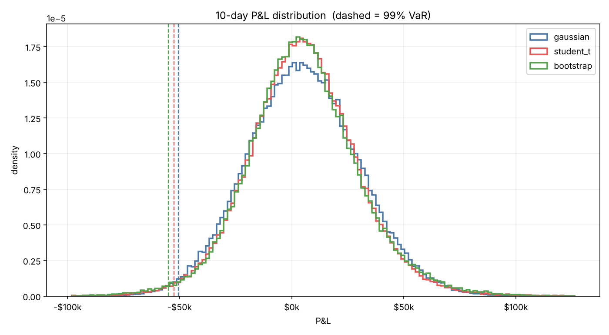
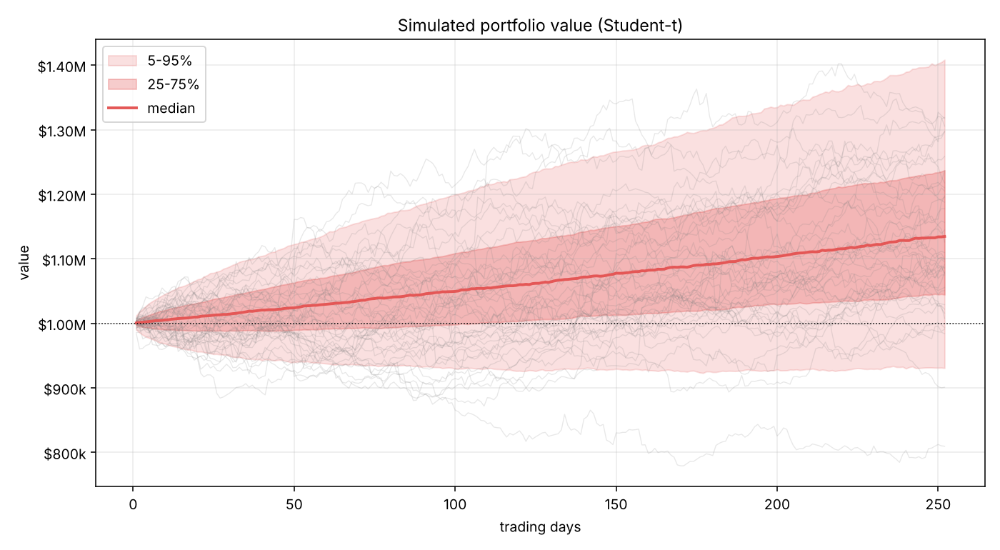
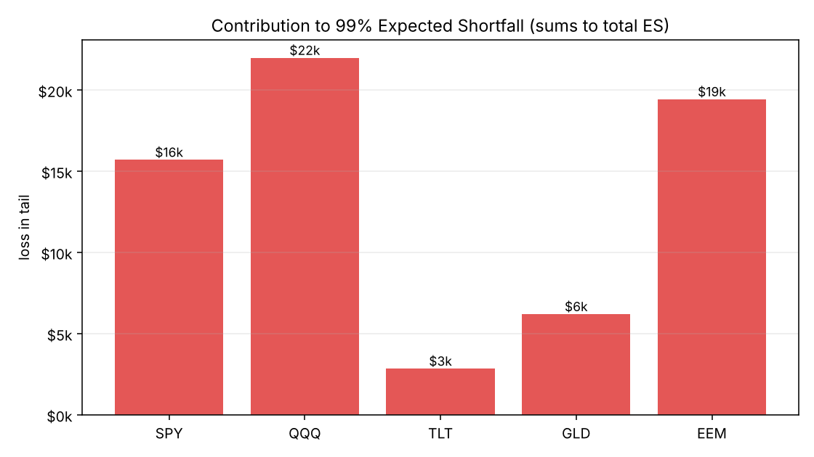
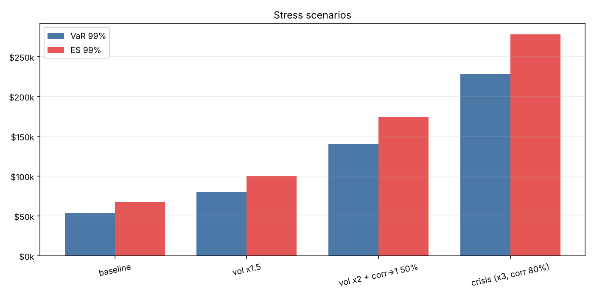
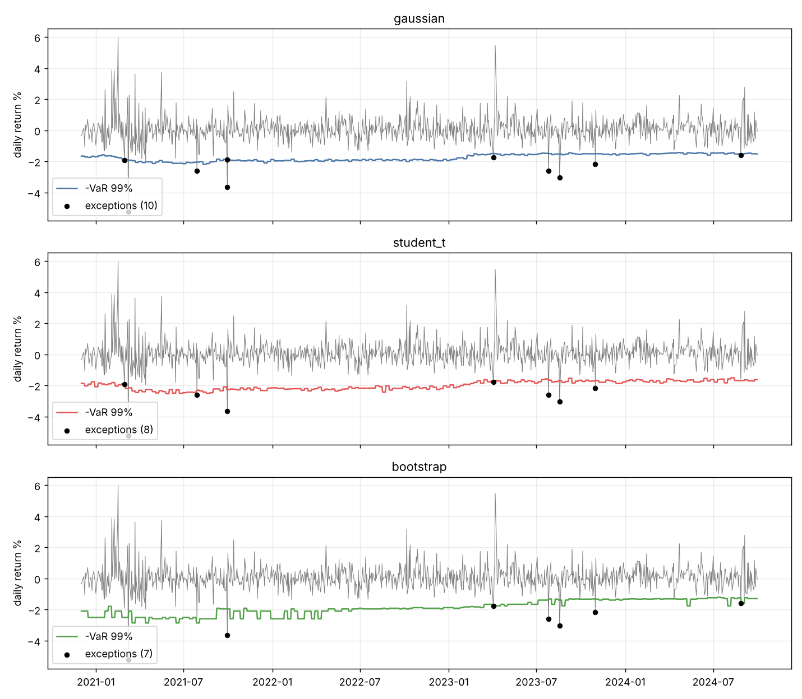

# 🎲 Monte Carlo Portfolio Risk

[](https://github.com/YOUR_USERNAME/monte-carlo-portfolio-risk/actions)


Estimate portfolio **Value-at-Risk**, **Expected Shortfall (CVaR)**, drawdowns and *tail-risk attribution* by simulating
100k+ correlated return paths. Compares **Gaussian vs fat-tailed Student-t vs historical bootstrap** engines, runs
**crisis stress tests**, and **backtests** the forecasts with formal statistical tests (Kupiec, Christoffersen).

<p align="center"></p>

## Why this exists

Gaussian VaR looks fine until markets stop being Gaussian. On fat-tailed data the three engines agree roughly on 99% VaR
but **disagree sharply on Expected Shortfall**: the Gaussian model understates average tail loss by ~12% in the demo below.
This repo makes that visible, quantified and testable.

## Quick start

```bash
git clone https://github.com/YOUR_USERNAME/monte-carlo-portfolio-risk && cd monte-carlo-portfolio-risk
pip install -e ".[dev]"

mcrisk                                       # offline demo on synthetic fat-tailed data
mcrisk --source yfinance --tickers SPY QQQ TLT GLD EEM --start 2018-01-01   # needs: pip install -e ".[yahoo]"
mcrisk --source csv --csv prices.csv --weights 0.4 0.3 0.3 --horizon 10 --alpha 0.99
pytest -q
```

Python API:

```python
from mcrisk.data import synthetic_prices
from mcrisk.estimation import log_returns, build_estimates
from mcrisk.model import monte_carlo
import numpy as np

rets = log_returns(synthetic_prices())
w = np.ones(5) / 5
est = build_estimates(rets, w)
summary, pnl, values, growth = monte_carlo(est, w, value=1e6, horizon=10, n_sims=100_000, method="student_t")
print(summary["VaR_99"], summary["ES_99"])
```

## Demo results

$1M, 5 assets (SPY/QQQ/TLT/GLD/EEM-style), equal weights, 10-day horizon, 100k simulations, synthetic data.

| | Gaussian | Student-t | Bootstrap |
|---|---:|---:|---:|
| VaR 99% | $50.6k | $52.6k | $55.0k |
| **ES 99%** | $58.2k | $66.2k | $67.3k |
| Excess kurtosis of P&L | 0.03 | 4.49 | 0.98 |

**Stress tests** (Student-t, 99%):

| Scenario | VaR | ES |
|---|---:|---:|
| Baseline | $53.5k | $67.3k |
| Vol ×1.5 | $80.4k | $99.9k |
| Vol ×2, correlations 50% → 1 | $140.6k | $174.0k |
| Crisis (vol ×3, correlations 80% → 1) | $228.6k | $277.8k |

**Rolling backtest** (1-day 99% VaR, 500-day window, ~1000 forecasts): all three engines pass Kupiec and Christoffersen
at 5%. Exceptions: 10 / 8 / 7 vs 10 expected.

> ⚠️ Numbers above come from a *synthetic* dataset built to be fat-tailed. Run on real prices before drawing conclusions.

<table>
<tr>
<td></td>
<td></td>
</tr>
<tr>
<td></td>
<td></td>
</tr>
</table>

## Features

| Stage | Module | What it does |
|---|---|---|
| Data | `data.py` | Synthetic regime-switching data, CSV, Yahoo Finance |
| Estimation | `estimation.py` | Ledoit-Wolf shrunk correlation, Student-t degrees of freedom by MLE |
| Simulation | `simulate.py` | Gaussian, multivariate Student-t (shared mixing → joint crashes), historical bootstrap |
| Risk | `risk.py` | VaR, ES, bootstrap CI on VaR, max drawdown, **component ES** (Euler allocation, sums to total) |
| Stress | `stress.py` | Vol multipliers + correlation-toward-1 blending |
| Backtest | `backtest.py` | Rolling re-estimation, Kupiec POF, Christoffersen independence |
| Reporting | `report.py`, `run.py` | Charts, `results.json`, CLI |

## Method notes

- Daily log returns; portfolio is **buy-and-hold** (weights fixed at t₀) so component ES is exactly additive.
- Student-t draws are rescaled by `√((ν−2)/ν)` so the covariance matches the estimate: the *only* difference vs Gaussian
  is tail shape and tail dependence.
- Horizon risk is simulated path-by-path, not scaled with the √t rule.
- VaR / ES are reported as positive losses.

## Limitations

- IID daily shocks: no volatility clustering inside the simulator (try GARCH / filtered historical simulation).
- Linear positions only: options and convex bonds need full revaluation.
- Parameters come from history; regimes absent from the sample show up only through stress tests.

## Roadmap

- [ ] GARCH(1,1) / DCC dynamics
- [ ] Filtered historical simulation
- [ ] EVT (GPD) tail fit
- [ ] Basel traffic-light classification of backtest exceptions
- [ ] Min-ES portfolio optimisation

## License

MIT
